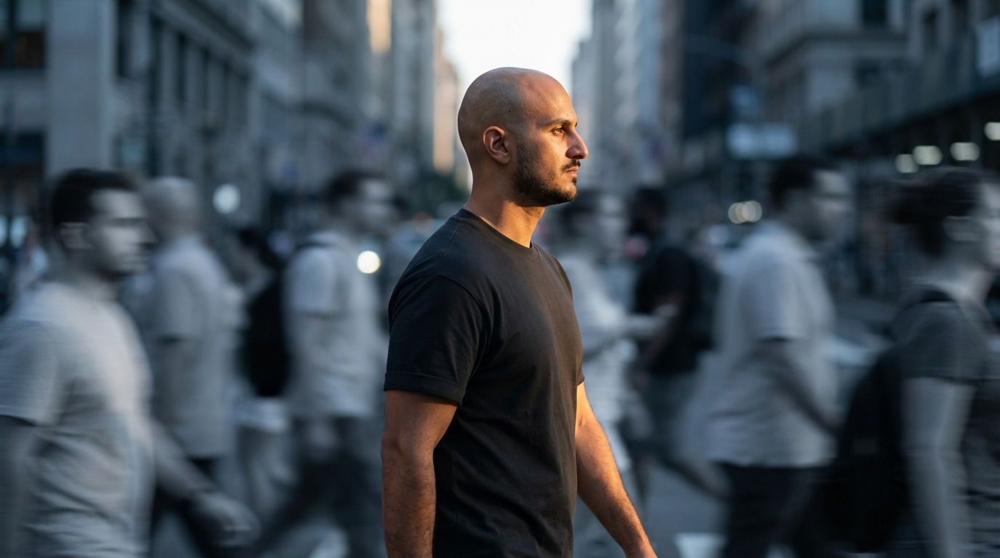
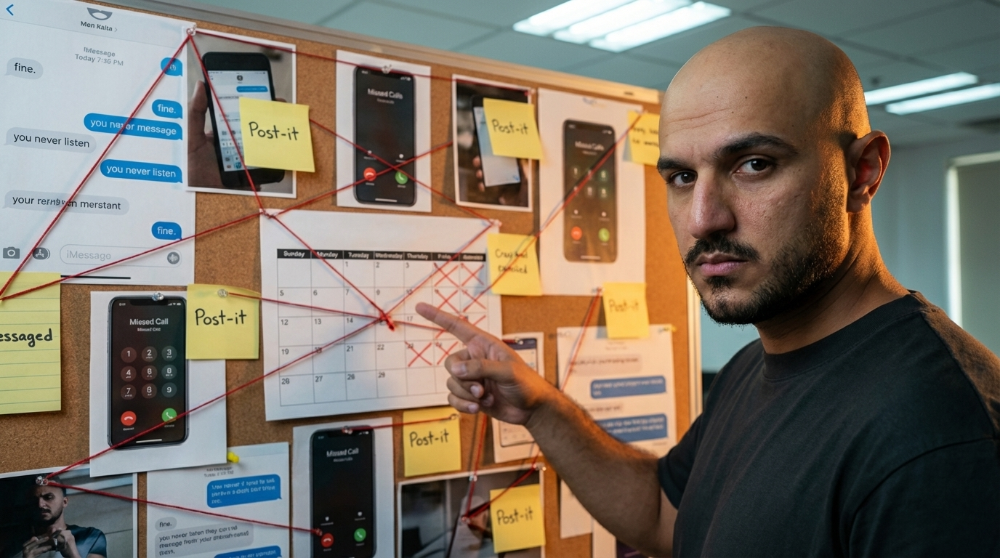
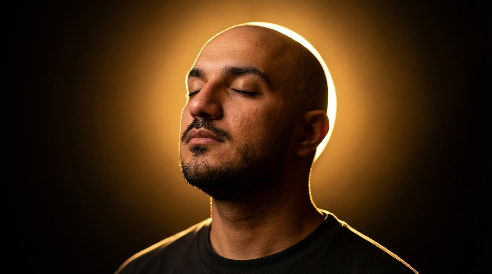
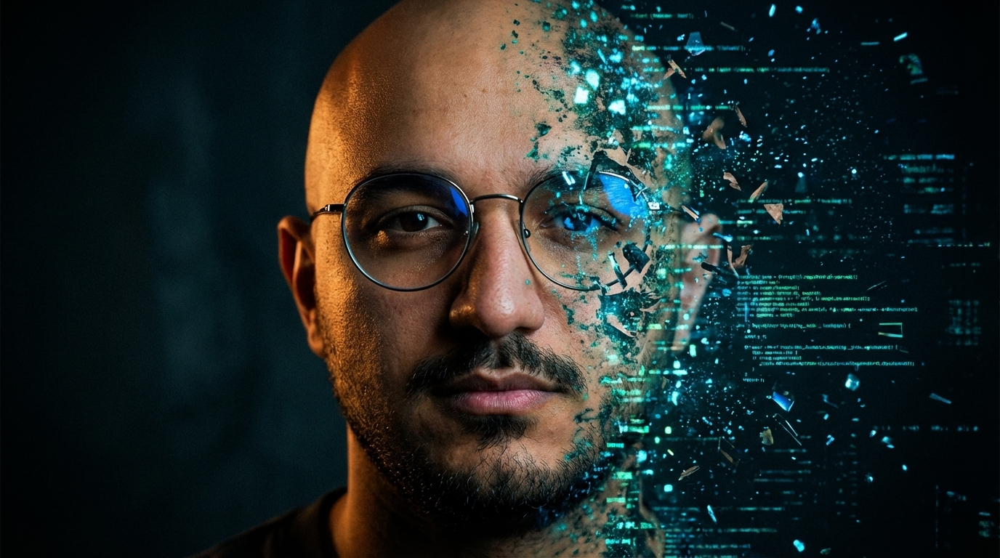
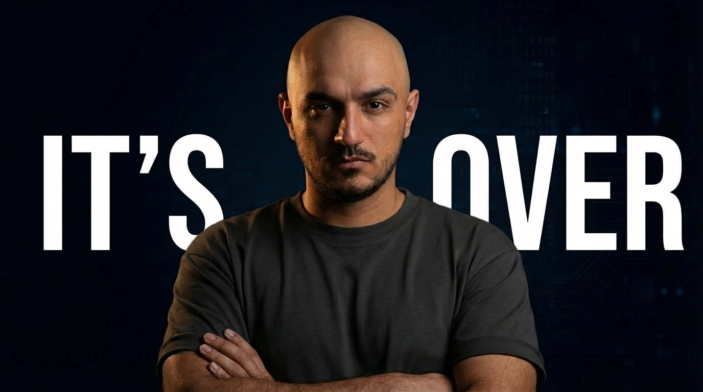
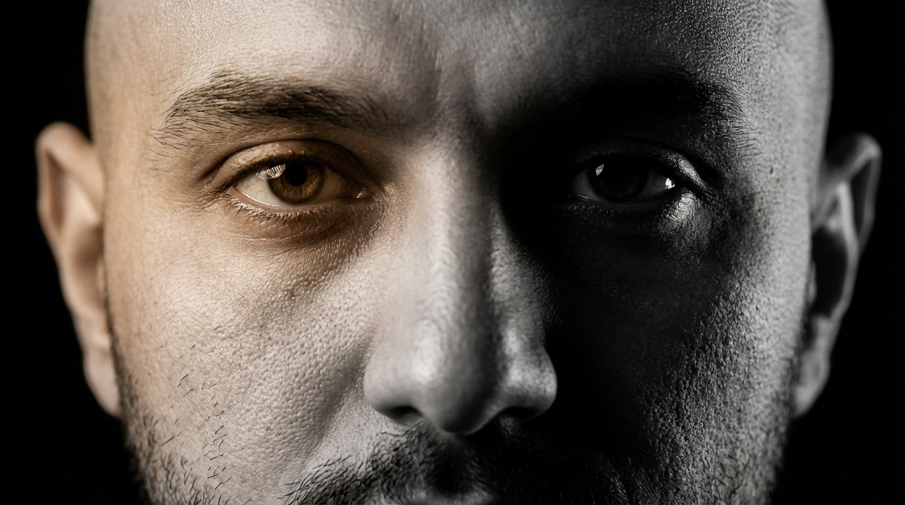
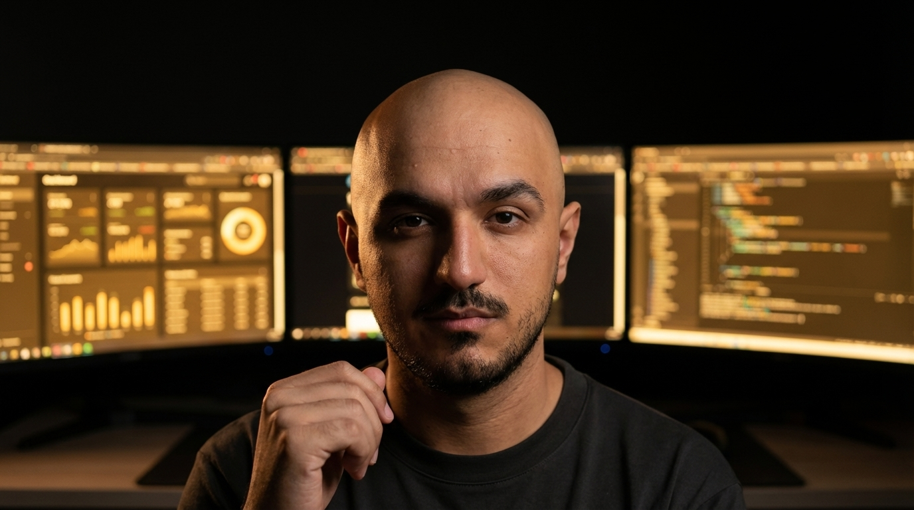
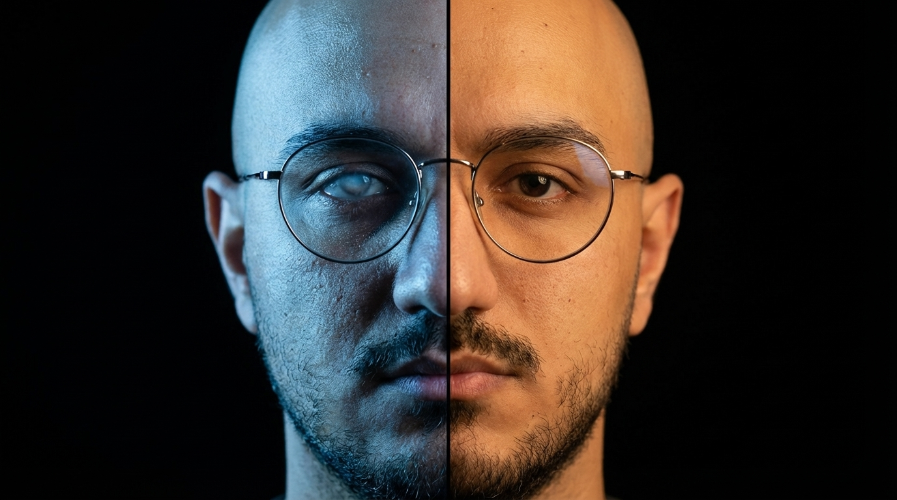
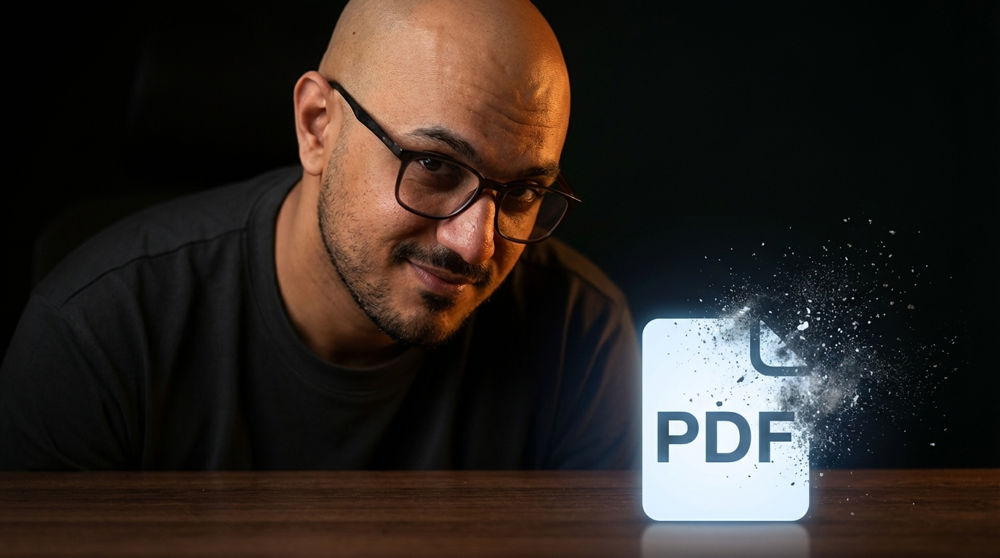

# Aesthetic Thumbnails

Aesthetic, photorealistic, original YouTube thumbnails — researched, designed, and generated by AI in a single session. Auto improves the more you use it. 

<table>
  <tr>
    <th>Artistic</th>
    <th>Enviroment</th>
    <th>Extreme</th>
    <th>Text & Icons</th>
  </tr>
  <tr>
    <td></td>
    <td></td>
    <td></td>
    <td></td>
  </tr>
  <tr>
    <td></td>
    <td></td>
    <td></td>
    <td></td>
  </tr>
  <tr>
    <td></td>
    <td></td>
    <td></td>
    <td></td>
  </tr>
</table>

> Every image above was generated from a headshot and description. No Photoshop, canva or templates.

---

## Quick Start

Open [Claude Code](https://claude.ai/download) anywhere and paste this:

```
Clone https://github.com/younessili/aesthetic-thumbnails.git, cd into it,
read the CLAUDE.md, and help me get set up. Walk me through everything —
API keys, headshots, brand setup — then let's make my first thumbnail.
```

> [!TIP]
> That's the whole setup. Pim (the creative director built into this tool) handles cloning, installing, configuring, and your first thumbnail session.

**Requirements:** [Python 3.10+](https://python.org) · [Claude Code](https://claude.ai/download) · [Gemini API key](https://ai.google.dev) (free) · a few photos of yourself

---

## How It Works

3-phase creative workflow. Not a template filler.

| Phase | What happens |
|-------|-------------|
| **Research** | Studies the thumbnails you like (your inspiration folder) and, optionally, outlier thumbnails in your niche — what's working, what's not, and where the visual gap is. |
| **Design** | Proposes 2-3 original visual metaphor concepts — each with mood, color palette, headshot selection and style references. Grounded in research, visual psychology and aesthetic. |
| **Generate** | Generates photorealistic thumbnails with the image model you choose. Then dispatches an unbiased subagent to evaluate against 4 quality gates + 12 diagnostic checkpoints, pairs each with 3 title options, and live previews across YouTube contexts (desktop, mobile, TV). |
| **Refine** | Waits for your feedback, runs evals again until you're happy, then saves the final thumbnail and title and updates learnings from the session for auto-improvement. |

---

## Optional Upgrades

The core only needs a Gemini key and your headshots. Each of these makes it better, and Pim adapts to whatever you've set up:

| Upgrade | How to turn it on | What you get |
|---------|------------------|--------------|
| **Your style** | Drop 3-10 thumbnails you love into `assets/inspiration/` | Pim studies them for concepts and passes the best matches to the image model as style references — the biggest step toward thumbnails that look designed but still real. |
| **More image models** | Add a [fal.ai](https://fal.ai/dashboard/keys) key as `FAL_KEY` in `.env` | GPT Image 2.5 (best text), Nano Banana 2.1 (cheapest), FLUX 3 — set a default with `IMAGE_MODEL` or ask Pim to switch. |
| **Outlier research** | Add a free YouTube Data API key as `YOUTUBE_API_KEY` in `.env` | Finds videos in your niche that massively outperformed their channel, so concepts start from data. |

Your headshots and inspiration thumbnails are gitignored — they never leave your machine except as API calls to the image model.

---

## Image Models

| Model | Key | ~Cost / image | Good at |
|-------|-----|--------------|---------|
| Nano Banana Pro (`gemini`, default) | `GEMINI_API_KEY` | $0.134 | Strong all-rounder, realistic. Occasionally drifts on likeness. |
| GPT Image 2.5 Sunburst / Flare | `FAL_KEY` | $0.064 | Cleanest text and layout, strong likeness. |
| Nano Banana 2.1 | `FAL_KEY` | ~$0.05 | Realistic and cheap. |
| Nano Banana Pro via fal (`nano-banana-pro`) | `FAL_KEY` | $0.15 | Same as `gemini`, billed through fal. |
| FLUX 3 | `FAL_KEY` | $0.10 | Very photographic skin; garbles small text. |

Run `.venv/bin/python execution/generate_thumbnail.py --list-models` for the full list with image limits.

---

## Cost

| Operation | Estimated Cost |
|-----------|---------------|
| Thumbnail generation | ~$0.05–0.15 per image depending on the model |
| Outlier research | Free (YouTube API) |
| Headshot analysis | ~$0.002 per image |
| **Typical session** | **$0.50 - $2.00** |

All API keys stay local — stored in your `.env` file, never uploaded.

---

## Questions?

Join the [newsletter](https://newsletter.aliyounessi.com) and reply to any email. Open a [GitHub issue](https://github.com/younessili/aesthetic-thumbnails/issues). Or DM me on social.

---

## Credits

Built by [Ali Younessi](https://aliyounessi.com) / [OperateU](https://aliyounessi.com).

[YouTube](https://youtube.com/@Ali_Younessi) · [Instagram](https://instagram.com/ali_younessi) · [Newsletter](https://newsletter.aliyounessi.com)

---

## License

MIT — free to use, customize, and fork.

This tool is actively developed. Future updates are free via `git pull`. Customizing core files may cause update conflicts — most people use it as-is.
